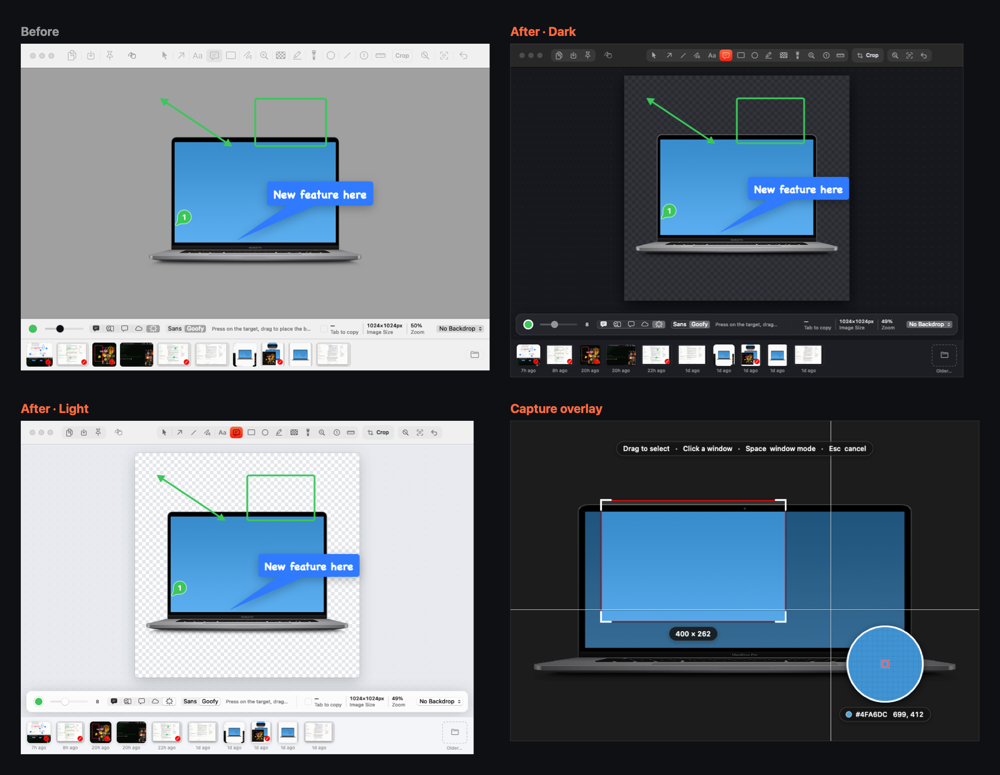

# ScreenShot

A recreation of [Shottr](https://shottr.cc) 1.9.3 (`cc.ffitch.shottr`) for macOS 14+, written in Swift/AppKit. It was rebuilt from static analysis of the installed `/Applications/Shottr.app` with REA plus the macOS tools `otool`, `strings` and `plutil`. No Shottr code was copied.

## Install

Download `ScreenShot-<version>.zip` (versions are dates: `261023.1` is the first release of 23 Oct 2026) from [Releases](https://github.com/Domi-X-in/ScreenShot/releases/latest), unzip it and move **ScreenShot** to Applications. The app is not notarized yet, so the first launch is blocked with *"ScreenShot.app" Not Opened*: click **Done** (not Move to Trash), then open **System Settings › Privacy & Security** and click **Open Anyway** (it shows for about an hour after the blocked launch). Right-click › Open no longer skips this check on macOS 15 and later. In Terminal, `xattr -dr com.apple.quarantine /Applications/ScreenShot.app` does the same. After that, new versions install themselves: the app checks GitHub once a day, and **Check for Updates…** is in the menu bar icon and in Preferences › Advanced.

## First launch

A welcome guide opens the first time: what the app does (with a live demo of a capture being marked up), an animation of the menu bar icon and its menu (Open ScreenShot) and of ⇧⌘2 starting a capture, Screen Recording permission with a status that turns green when it's granted, the Screenshots folder and what happens after each capture, Light / Dark / System appearance with live previews, the shortcuts, and a button to take the first screenshot. If macOS quits the app to apply the permission, the guide resumes where it was. **Welcome Guide…** in the menu bar menu opens it again.

## Home window

**Open ScreenShot** (first item in the menu bar menu, ⌘L) opens the app's home window: Area, Window and Fullscreen capture buttons, every screenshot in the Library with search, and buttons for the folder, opening another image and Preferences. Opening the app again from Finder or Spotlight shows it too.

## Build and run

```bash
./build.sh
```

```bash
open build/ScreenShot.app
```

Only the Command Line Tools are needed (SwiftPM, no Xcode). The app lives in the menu bar (camera icon).
On first use, macOS asks for **Screen Recording** permission. Automatic scrolling capture also needs **Accessibility**.
The bundle is signed ad hoc with its designated requirement pinned to the bundle id, so the permissions survive rebuilds.

## What the analysis found in Shottr

| Evidence in the binary | What it means | What it maps to here |
|---|---|---|
| Swift + AppKit, storyboards `Main/Preview/Pin/Preferences/Library` | Native AppKit UI | AppKit; SwiftUI only for Preferences |
| Links `ScreenCaptureKit` | Captures screens and windows | `Capturer.swift` |
| `CurtainWindowController`, `RegionSelector`, `CrosshairView` | Frozen-screen overlay for picking an area | `Curtain.swift` (crosshair, pixel loupe, size, window highlight) |
| `ShotView`, `PreviewViewController`, `CtrlToolbar` | Editor | `ShotView.swift`, `EditorWindow.swift` |
| `ObjArrow/Rectangle/Oval/Line/Text/Highlighter/Counter/Spotlight/Freehand/Magnifier/Ruler/Conceal`, `CropTool`, `Backdrop` | Annotation tools | `Annotation.swift` (`Tool` + `Renderer`) |
| Strings "Arrow (A)", "Rectangle (R)", "Blur/Erase (B)", "Counter (C)", "Spotlight (S)", "Freehand Drawing (D)", "Magnifier (M)", "Ruler (1 or 2)", "Backdrop (K)" | Single-key tool shortcuts | Same keys (+ `V` select, `X` crop) |
| `PinWindowController` | Floating pinned screenshots | `Pin.swift` |
| `ScrollCapturer`, `VisionStitcher`, `cbReverseAutoscroll`, `slScrollingSpeed` | Scrolling capture with stitching | `ScrollCapture.swift` (posts scroll events + row-matching stitch) |
| Links `Vision`, "Recognize Text/QR", `cbRemoveBreaksOCR` | Text and QR recognition | `OCR.swift` |
| `CarbonKeyboardShortcuts` (sindresorhus/KeyboardShortcuts) | Global hotkeys | `HotKeys.swift` (Carbon `RegisterEventHotKey`) |
| `LaunchAtLoginHelper.app` | Launch at login | `SMAppService` |
| `cbAfterGrabCopy/Save/Show`, `cbEscCopy/Save`, `rbSaveFormatAuto/PNG` | Preferences | `Settings.swift`, `Preferences.swift` |
| Deep links `shottr://grab/...` | URL scheme | `screenshot://grab/area`, `grab/fullscreen`, `grab/window`, `grab/window/active`, `grab/scrolling`, `grab/scrolling/manual`, `grab/repeat`, `grab/delayed`, `ocr`, `load/clipboard` |

## UI recreated from Shottr's Interface Builder files

REA's `decode_interface_builder` decoded all 17 compiled storyboards (3,431 objects), and `assetutil` listed the asset catalog. This is what the app copies from them:

- **Editor** (Main.storyboard `MainWindowController`): unified toolbar with Copy (Esc or ⌘C) · Save (⌘S) · Pin to Screen (⌘P), drag-out handle, tool strip, **Crop** text button, adjust buttons (Resize ( ⇧+] ), Recognize Text or QR (⌘O), Reset Selection (Esc)), and the info cells "#FFFFFF / Tab to copy", "W×Hpx / Selection Size", "NN% / Zoom". Below the canvas is a per-tool options row: color, size, arrow style, solid/dash, fill (transparent/translucent/opaque), Blur/Erase, font (sans/goofy), counter shape, PX/PT.
- **Colors**: `clrMain` #FF0C01 (selection accent), `clrToolbarLabel` #282828/#D0D0D0 and `clrToolbarInfo` #747474/#A2A2A2 (light/dark).
- **Preferences** (Preferences.storyboard): icon tabs General · Hotkeys · Advanced in a 520-pt window, right-aligned labels and controls from x=238, with the same wording ("After screenshot: Show Copy Save", "After Area Crop, show: Thumbnail / Editor", "Window Screenshot Background", …).
- **Pin** (Pin.storyboard): hover bar with drag-out, Edit and Copy, a close button, and the menu Edit · Copy · 50% · 100% · 200% · Semi-transparent · Close.
- **Thumbnail** (Preview.storyboard, 267×270): close button, grip, draggable preview, and the Edit · Copy · Save · OCR · Pin row.

Icons are SF Symbols. Shottr's own icon artwork is not copied.

To check the UI without Screen Recording permission, run the binary with `SCREENSHOT_SNAPSHOT_DIR=<dir> SCREENSHOT_SNAPSHOT_IMAGE=<png>`. It renders the editor, preferences, pin and thumbnail to PNG files, then quits.

## Editable saves and the recent strip

- **Saving keeps annotations editable.** ⌘S, Save As and Esc-to-save store the original image and every object (text, arrows, counters, blur, magnifier, pasted images, backdrop) with the file. For PNG it goes in a private `scED` chunk inside the file, which other apps ignore and drop if they modify the image. For JPEG it goes in a hidden `.<name>.screenshot-edit` file next to it, which is ignored if the JPEG changes elsewhere. Reopening the file restores the objects, and ⌘S updates the same file.
- **Auto-save.** Every change (adding, moving, restyling or deleting an object, typing, crop, undo) is written to the file about a second later, with objects kept editable. Switching files or closing the window saves right away. A new capture gets a file in the Screenshots folder on its first edit; with "After screenshot: Save" on, the editor works on that saved file instead of making a second copy.
- **Recent strip** at the bottom of the editor: the 10 newest images in the Screenshots folder, by creation date (kept across auto-saves, so tiles don't jump around). A pencil badge marks editable ones. Clicking a thumbnail switches the same editor window to that file, and each file keeps its undo history while the window is open. Right-click offers Edit Here, Open in New Window, Copy Image and Show in Finder. The last tile opens the Library.
- **Library** (that tile, ⌘L, or the menu bar icon): every image in the Screenshots folder, newest first, with a thumbnail-size slider. Search matches file names, dates ("2026-10-21", "october") and the **text inside each screenshot**, which is recognized in the background and cached in `~/Library/Application Support/ScreenShot/text-index.json`. Click a screenshot to edit it.
- **Copy/paste between editors.** ⌘C with an object selected copies the object, and ⌘V pastes it into any editor window. ⌘C with nothing selected copies the image, and ⌘V in another editor adds it as a movable image overlay; pinch or scroll over it to resize.

## Color, size and zoom (Shottr's info boxes)

The bottom bar shows three cells that stay visible on any screen width. Each opens a panel when clicked, as in Shottr:
- **Color** (`colorBoxClicked:`): **Tab** copies the pixel color under the cursor, **Shift+Tab** the darkest color within 20 px (text color), and **C** in the Crop tool the average color of the selection. The **Color Format** menu chooses what gets copied: HEX `#FFC200`, HEX `FFC200`, CSS `rgba(255, 194, 0, 1)`, RGB `(1.00, 0.76, 0.00)`, Android `0xFFFFC200`, UIColor, C# `Color.fromArgb()`, or OKLCH.
- **Size** (`sizeBoxClicked:`, also the toolbar's Resize button and ⇧]): **Resize Image** with linked width × height fields, presets 25% / 33% / 50% / 1× / 2× / 4×, and **Show Size in Logical Points** (shortcut **P**). Resizing can be undone.
- **Zoom** (`zoomBoxClicked:`): − / 100% / +, plus Fit to Window. Preferences › Advanced adds **Zoom with mouse wheel** and **Default zoom level: Prefer 100%**.

## Look and feel



- **Canvas:** a dot grid that adapts to light and dark mode. The screenshot floats on a soft shadow, and transparent pixels show a checkerboard.
- **Toolbar:** custom palettes (`Theme.swift`) with tools grouped as select · draw · text · shapes · effects · counter/ruler. The active tool gets a glowing red-orange pill (built around Shottr's #FF0C01), and other buttons highlight on hover and press. Crop is a pill button.
- **Options card:** floats over the bottom of the canvas, with a ringed color swatch, a live size readout and the color/size/zoom cells.
- **Recent strip:** shadowed tiles that lift on hover, "2m ago" captions, the current file outlined in the accent, and a dashed "Library" tile.
- **Capture overlay:** accent selection with white corner brackets, a frosted size pill, a double-line crosshair, and a circular loupe with a pixel grid and a color readout.
- **Toasts:** a ✓ / ⚠ / working icon picked from the message, in a frosted capsule that springs in.
- **Preferences:** an app header with the icon and version.
- **Appearance** (Preferences › General): System follows macOS; Light or Dark sets ScreenShot's windows only, takes effect immediately, and is remembered.

## Backdrop, Cut Out and other Shottr tools

- **Backdrop** (button at the right of the options card, `K` toggles): 10 color presets; Solid, Color Blend, Vertical, Diagonal, Radial or Mesh gradient, or the screenshot itself blurred; aspect ratio Auto, 1:1, 4:3, 3:2, 16:9, Twitter/X, Facebook, YouTube, LinkedIn or Pinterest; sliders for padding, shadow, inset (a frosted frame), outer and inner corner radius. With the Select tool, drag the background to move the screenshot inside it; **Recenter** puts it back. **Set as Default** makes `K` use that look everywhere. Files saved with the old backdrop presets still open.
- **Cut Out** (`⇧X`, or the Crop / Cut Out switch): drag up or down over rows, or sideways over columns, then Enter. The strip is removed, the two sides join, and annotations past it move with the image.
- **Autoadjust** (Crop, `F`): shrinks the selection (or the whole image) to the content, dropping edges that are one flat color.
- **Imprint Size** (Crop, `I`): stamps a dashed outline and "W × H px" on the image.
- **Measure:** hold `1` for the distances across the area under the pointer, or `2` for its bounding box; a quick tap picks the Ruler.
- **OCR of an area:** with a Crop selection, ⌘O reads only that part. Preferences › Advanced › **OCR main language** chooses what Vision reads first.
- **Hand-drawn style** for arrows, lines, rectangles and ovals (Clean / Hand-Drawn switch in the options bar).
- **Blinking GIF** (File › Save Blinking GIF, `⇧⌘G`): a looping two-frame GIF that shows the screenshot with and without the annotations.
- **Capture settings:** hide the menu bar icon (open the app again to get Preferences); mouse pointer Auto (fullscreen only) / Include / Exclude; save Retina screenshots at 1×; window background None / Desktop wallpaper / Color; maximum scrolling capture height; turn `screenshot://` links on or off.

## Shapes like in PowerPoint

- **Text in shapes:** select a rectangle or oval and press **Return** (or double-click it) to type inside; the text is centered and wraps to the shape. Styling the text leaves the outline's color and width alone. A shape with text or fill can be grabbed from anywhere inside it.
- **Arrange** (menu bar › Arrange, the Arrange button in the options bar, or right-click an object): Align Left / Center / Right / Top / Middle / Bottom, Distribute Horizontally / Vertically (three or more objects, equal gaps), Bring to Front ⇧⌘F, Bring Forward ⌥⇧⌘F, Send Backward ⌥⇧⌘B, Send to Back ⇧⌘B. One selected object aligns to the screenshot.
- **Smart guides:** when you move, draw or resize a shape, its edges and center snap to the edges and centers of the other objects and of the screenshot, and a pink guide shows what lines up. Hold ⌘ while dragging to place freely; Arrange › Snap to Guides turns it off.
- **Room for everything:** objects placed past the screenshot's edges (a pasted image, an arrow, a box) grow the picture to include them, so copying and saving keep them. The new area is transparent (white in JPEG) and shows a checkerboard in the editor.

## Option defaults

New annotations start from **defaults**. The built-in ones include **Professional · Box** for the Callout, red, size 4, the shaped arrow, a solid line, no fill, Blur, Sans, the circle counter, px, an oval lens at 2×. Picking an option affects the current editor only. To make an option the default, **right-click** it (callout design, arrow, line, fill, blur mode, font, counter shape, ruler units, lens shape and zoom) and choose **Set “…” as Default**. Right-clicking the color swatch or the size slider does the same for color and size. A small accent dot marks each control's default, and **Reset to Original Default** restores the built-in one.

## Editor shortcuts

`A` arrow · `R` rectangle · `O` oval · `L` line · `D` freehand · `T` text · `H` highlighter · `B` blur · `C` counter · `S` spotlight · `M` magnifier · `1`/`2` ruler (tap) or measure (hold) · `X` crop (Enter applies it) · `⇧X` cut out · `F` autoadjust · `I` imprint size · `V` select · `K` backdrop
Select (`V`, first button in the tool strip): click to select, Shift-click to add/remove, drag on empty space to select several, ⌘A selects all. Drag to move the selection, ⌥-drag duplicates it, arrow keys nudge (Shift ×10), Delete removes it, ⌘D duplicates, ⌘C/⌘V copy and paste it. A single selected box (rectangle, oval, blur, highlight, spotlight, magnifier, image) gets 8 resize handles, and Shift on a corner keeps proportions (always for images). Arrows, lines and rulers get endpoint handles. Options-bar changes apply to every selected object.
Callout (`E`, after Text in the tool strip): press on what you want to point at and drag to where the bubble goes, then type. A plain click places the bubble up and to the right. Drag the white tip dot to re-aim the pointer anywhere. Dragging the bubble moves it while the tip stays on its target. Double-click to edit the text, which supports per-letter color, size and font like Text. Designs in the options bar: **Professional · Box** (solid, tapered pointer, shadow), **Professional · Card** (white card with colored border), **Informal · Speech** (rounded bubble with a swooping tail), **Fun · Thought** (cloud with a bubble trail), **Fun · Shout** (comic starburst whose spike reaches the target).
Blur (`B`): Shottr's four conceal types from the options bar. **Blur** is an averaging mosaic over the area, **Blur Text** applies it only to the text lines Vision finds inside the area, **Erase** fills with the dominant surrounding color, and **Erase Text** fills only the text lines. Regions re-conceal what is under them when moved.
Magnifier (`M`): drag over an area to create a lens (Shottr's ObjMagnifier: factor, lensX/lensY, border, connector line); drag the lens to move it, pinch/scroll/`+`/`−` over a selected magnifier to zoom (1.25×–8×), oval or rect shape in the options bar.
`Tab` copies the color under the cursor · pinch, ⌘-scroll or ⌘=/⌘−/⌘0 zoom · `Esc` copies and closes (configurable) · `⌘C` copy · `⌘S` save · `⌘⇧S` save as · `⌘P` pin · `⌘Z`/`⌘⇧Z` undo/redo · `⌫` deletes the selected object · arrow keys nudge it · `Shift` constrains angles and squares.

## Default global shortcuts

`⌘⇧1` fullscreen · `⌘⇧2` area · `⌘⇧7` any window · `⌘⇧8` scrolling · `⌘⇧9` text/QR · `⌘⇧0` repeat area. You can change them in Preferences › Hotkeys.

## Tests

```
Tools/test.sh                      # unit tests (swift test)
Tools/integration-tests.sh         # in-app self-tests on the debug build
Tools/integration-tests.sh --live  # also real captures (needs Screen Recording and an unlocked screen)
```

## Releases and updates

```
Tools/release.sh --dry-run         # build, zip and appcast in dist/, nothing published
Tools/release.sh                   # also tags v<version>, pushes and creates the GitHub release
Tools/update-e2e-test.sh           # an old copy updates itself from a local server
Tools/update-e2e-test.sh --tampered  # an update with a wrong signature is refused
```

- Versions are dates, **YYMMDD.N** in local time: the first release on 23 Oct 2026 is `261023.1`, a second one that day `261023.2`, and the next day starts again at `.1`. The script works the number out from the existing tags. Builds that aren't releases are `YYMMDD.0`, so they're always older than that day's release.
- Updates use [Sparkle](https://sparkle-project.org) 2.10. Each release zip is signed with an EdDSA key, and the app only installs updates whose signature matches `SUPublicEDKey` in `Resources/Info.plist`. The private key is in the login Keychain (account `local.screenshot.app`) and in `~/.screenshot-release/sparkle_ed25519.key`. Keep a copy somewhere safe: without it, installed copies can't be updated.
- `appcast.xml` is attached to every release, and the app reads it from `releases/latest/download/appcast.xml`.
- Notarization, once you have an Apple Developer account: `DEVELOPER_ID="Developer ID Application: Name (TEAMID)" NOTARY_PROFILE=<profile> Tools/release.sh`. This signs with the hardened runtime, notarizes and staples. Create the profile once with `xcrun notarytool store-credentials`.

## Not reproduced

Paid or service-backed features: license/payments, S3 and cloud upload, telemetry and the auto-updater. Backdrop image uploads (Shottr lets you pick any picture; here the image fill is the blurred screenshot).
