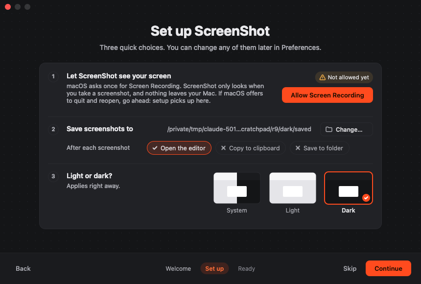
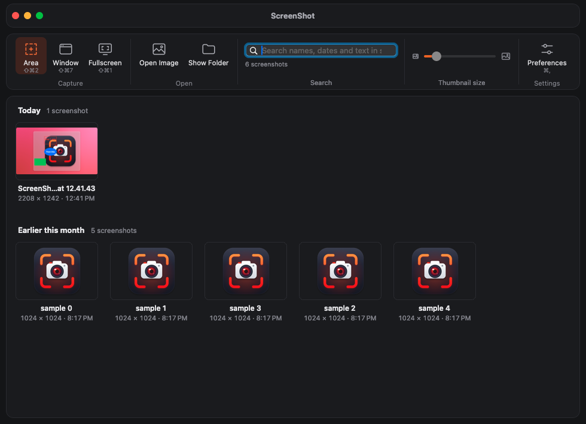
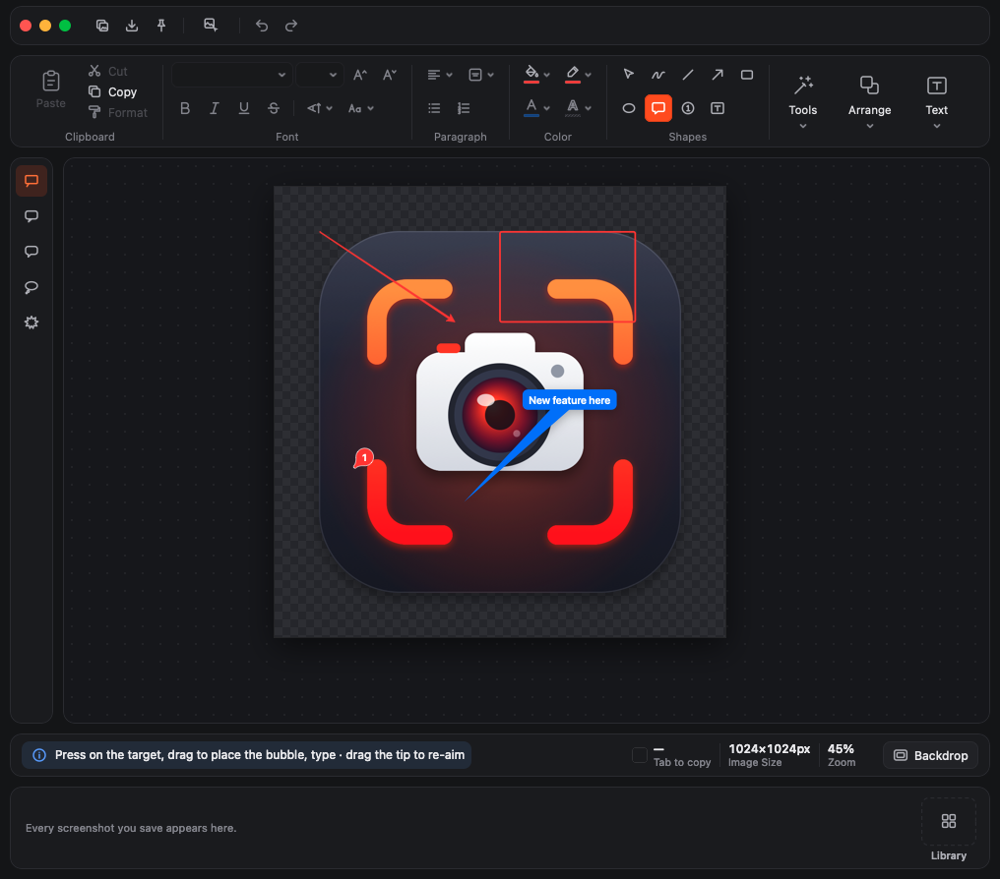

# ScreenShot

A recreation of [Shottr](https://shottr.cc) 1.9.3 (`cc.ffitch.shottr`) for macOS 14+, written in Swift/AppKit. It was rebuilt from static analysis of the installed `/Applications/Shottr.app` with REA plus the macOS tools `otool`, `strings` and `plutil`. No Shottr code was copied.

## Install

Download `ScreenShot-<version>.zip` (versions are dates: `261023.1` is the first release of 23 Oct 2026) from [Releases](https://github.com/Domi-X-in/ScreenShot/releases/latest), unzip it and move **ScreenShot** to Applications. The app is not notarized yet, so the first launch is blocked with *"ScreenShot.app" Not Opened*: click **Done** (not Move to Trash), then open **System Settings › Privacy & Security** and click **Open Anyway** (it shows for about an hour after the blocked launch). Right-click › Open no longer skips this check on macOS 15 and later. In Terminal, `xattr -dr com.apple.quarantine /Applications/ScreenShot.app` does the same. After that, new versions install themselves: the app checks GitHub once a day, and **Check for Updates…** is in the menu bar icon and in Preferences › Advanced.

## First launch

A three-step welcome guide opens the first time:

1. **Welcome**: what the app does, in three cards (Capture anything, Mark it up, Always one click away) that light up in turn.
2. **Set up**: Screen Recording permission with a status that turns green when it's granted, the Screenshots folder and what happens after each capture (open the editor, copy, save), and Light / Dark / System with live previews.
3. **Ready**: your capture shortcuts and a button to take the first screenshot.

The step names in the footer jump between steps; Skip goes to the last one. If macOS quits the app to apply the permission, the guide resumes on the step it was on. With macOS's **Reduce Motion** on, nothing animates. **Welcome Guide…** in the menu bar menu opens it again.



## Dock

The app has a Dock icon by default, and so the full menu bar while it is in front; turn it off in Preferences › General. Over another app in full screen, the capture windows and pins stay on that Space. The editor opens on the desktop's Space, as any app's window does, and Copy and Close goes back to the full-screen app.

**Clicking the Dock icon**, or opening the app from Finder or Spotlight, always shows the editor. The red button, ⌘W, Esc, Pin, Copy and Close and Save and Close only hide it, so it comes back as it was, with its undo history. With no editor yet (after launching), it opens the newest screenshot, or the home window if the folder is empty. Launching the app at login shows nothing.

## Home window

**Open ScreenShot** (first item in the menu bar menu, ⌘L) opens the app's home window, made of floating cards like the editor: a ribbon-style bar with Area, Window and Fullscreen capture buttons (each with its shortcut), Open Image and Show Folder, search, the thumbnail size and Preferences; below it every screenshot, grouped by day (Today, Yesterday, Earlier this week, Earlier this month, then by month), each with its name, pixel size and time. 



## Build and run

```bash
./build.sh
```

```bash
open build/ScreenShot.app
```

Only the Command Line Tools are needed (SwiftPM, no Xcode). The app lives in the Dock and the menu bar (viewfinder icon).
On first use, macOS asks for **Screen Recording** permission. Automatic scrolling capture also needs **Accessibility**.
The bundle is signed ad hoc with its designated requirement pinned to the bundle id, so the permissions survive rebuilds.

## What the analysis found in Shottr

| Evidence in the binary | What it means | What it maps to here |
|---|---|---|
| Swift + AppKit, storyboards `Main/Preview/Pin/Preferences/Library` | Native AppKit UI | AppKit; SwiftUI only for Preferences |
| Links `ScreenCaptureKit` | Captures screens and windows | `Capturer.swift` |
| `CurtainWindowController`, `RegionSelector`, `CrosshairView` | Frozen-screen overlay for picking an area | `Curtain.swift` (crosshair, pixel loupe, size, window highlight) |
| `ShotView`, `PreviewViewController`, `CtrlToolbar` | Editor | `ShotView.swift`, `EditorWindow.swift` |
| `ObjArrow/Rectangle/Oval/Line/Text/Highlighter/Counter/Spotlight/Freehand/Magnifier/Ruler/Conceal`, `CropTool`, `Backdrop` | Annotation tools | `Annotation.swift` (`Tool` + `Renderer`) |
| Strings "Arrow (A)", "Rectangle (R)", "Blur/Erase (B)", "Counter (C)", "Spotlight (S)", "Freehand Drawing (D)", "Magnifier (M)", "Ruler (1 or 2)", "Backdrop (K)" | Single-key tool shortcuts | Same keys (+ `V` select, `X` crop) |
| `PinWindowController` | Floating pinned screenshots | `Pin.swift` |
| `ScrollCapturer`, `VisionStitcher`, `cbReverseAutoscroll`, `slScrollingSpeed` | Scrolling capture with stitching | `ScrollCapture.swift` (posts scroll events + row-matching stitch) |
| Links `Vision`, "Recognize Text/QR", `cbRemoveBreaksOCR` | Text and QR recognition | `OCR.swift` |
| `CarbonKeyboardShortcuts` (sindresorhus/KeyboardShortcuts) | Global hotkeys | `HotKeys.swift` (Carbon `RegisterEventHotKey`) |
| `LaunchAtLoginHelper.app` | Launch at login | `SMAppService` |
| `cbAfterGrabCopy/Save/Show`, `cbEscCopy/Save`, `rbSaveFormatAuto/PNG` | Preferences | `Settings.swift`, `Preferences.swift` |
| Deep links `shottr://grab/...` | URL scheme | `screenshot://grab/area`, `grab/fullscreen`, `grab/window`, `grab/window/active`, `grab/scrolling`, `grab/scrolling/manual`, `grab/repeat`, `grab/delayed`, `ocr`, `load/clipboard` |

## UI recreated from Shottr's Interface Builder files

REA's `decode_interface_builder` decoded all 17 compiled storyboards (3,431 objects), and `assetutil` listed the asset catalog. This is what the app copies from them:

- **Editor** (Main.storyboard `MainWindowController`): the commands and wording (Copy (Esc or ⌘C) · Save (⌘S) · Pin to Screen (⌘P), drag-out, Resize ( ⇧+] ), Recognize Text or QR (⌘O)), and the info cells "#FFFFFF / Tab to copy", "W×Hpx / Selection Size", "NN% / Zoom". The layout itself is this app's own Office-style redesign (see **Editor** below).
- **Preferences** (Preferences.storyboard): icon tabs General · Hotkeys · Advanced in a 520-pt window, right-aligned labels and controls from x=238, with the same wording ("After screenshot: Show Copy Save", "After Area Crop, show: Thumbnail / Editor", "Window Screenshot Background", …).
- **Pin** (Pin.storyboard): hover bar with drag-out, Edit and Copy, a close button, and the menu Edit · Copy · 50% · 100% · 200% · Semi-transparent · Close.
- **Thumbnail** (Preview.storyboard, 267×270): close button, grip, draggable preview, and the Edit · Copy · Save · OCR · Pin row.

Icons are this app's own family (`Icons.swift`: 1.5 pt strokes on a 24 pt grid); the floating thumbnail and pins still use SF Symbols. Shottr's own icon artwork is not copied.

To check the UI without Screen Recording permission, run the binary with `SCREENSHOT_SNAPSHOT_DIR=<dir> SCREENSHOT_SNAPSHOT_IMAGE=<png>`. It renders the editor (light or dark with `SCREENSHOT_SNAPSHOT_APPEARANCE`), its panels and ribbon widths, the home window, preferences, pin, thumbnail, icon sheet and the welcome guide to PNG files, then quits.

## Editable saves and the recent strip

- **Saving keeps annotations editable.** ⌘S, Save As and Esc-to-save store the original image and every object (text, arrows, counters, blur, magnifier, pasted images, backdrop) with the file. For PNG it goes in a private `scED` chunk inside the file, which other apps ignore and drop if they modify the image. For JPEG it goes in a hidden `.<name>.screenshot-edit` file next to it, which is ignored if the JPEG changes elsewhere. Reopening the file restores the objects, and ⌘S updates the same file.
- **Auto-save.** Every change (adding, moving, restyling or deleting an object, typing, crop, undo) is written to the file about a second later, with objects kept editable. Switching files or closing the window saves right away. A new capture gets a file in the Screenshots folder on its first edit, or when it leaves the editor (closing the window, or another picture replacing it), even with no edits; with "After screenshot: Save" on, the editor works on that saved file instead of making a second copy.
- **Recent strip** at the bottom of the editor: the 10 newest images in the Screenshots folder, by creation date (kept across auto-saves, so tiles don't jump around). A pencil badge marks editable ones. Clicking a thumbnail switches the same editor window to that file, and each file keeps its undo history while the window is open. Right-click offers Edit Here, Copy Image and Show in Finder. The last tile opens the Library.
- **Library** (that tile, ⌘L, or the menu bar icon): every image in the Screenshots folder, newest first, with a thumbnail-size slider. Search matches file names, dates ("2026-10-21", "october") and the **text inside each screenshot**, which is recognized in the background and cached in `~/Library/Application Support/ScreenShot/text-index.json`. Click a screenshot to edit it.
- **One editor window.** Every capture, opened file, clipboard image and Library item opens in the same editor window. The picture it replaces is auto-saved first, so it stays in the recent strip and the Library, still editable.
- **Copy/paste between pictures.** ⌘C with an object selected copies the object, and ⌘V pastes it into the next picture you open. ⌘C with nothing selected copies the image, and ⌘V adds it as a movable image overlay; pinch or scroll over it to resize.

## Color, size and zoom (Shottr's info boxes)

The editor's bottom bar shows three cells that stay visible on any screen width. Each opens a panel when clicked, as in Shottr:
- **Color** (`colorBoxClicked:`): **Tab** copies the pixel color under the cursor, **Shift+Tab** the darkest color within 20 px (text color), and **C** in the Crop tool the average color of the selection. The **Color Format** menu chooses what gets copied: HEX `#FFC200`, HEX `FFC200`, CSS `rgba(255, 194, 0, 1)`, RGB `(1.00, 0.76, 0.00)`, Android `0xFFFFC200`, UIColor, C# `Color.fromArgb()`, or OKLCH.
- **Size** (`sizeBoxClicked:`, also ⇧]): **Resize Image** with linked width × height fields, presets 25% / 33% / 50% / 1× / 2× / 4×, and **Show Size in Logical Points** (shortcut **P**). Resizing can be undone.
- **Zoom** (`zoomBoxClicked:`): − / 100% / +, plus Fit to Window. Preferences › Advanced adds **Zoom with mouse wheel** and **Default zoom level: Prefer 100%**.

## Editor



The editor is a set of floating cards on a dotted canvas, dark or light, with **#FF5500** as the accent (selection, the active tool, focus).

- **Title card:** the window buttons, Copy image, Save, Pin, the drag-out handle, and Undo / Redo. Drag it to move the window. **Copy and Close** and **Save and Close**: after copying or saving, every ScreenShot window closes except pins, and the app you were in before gets the focus back, so you can paste right away; the app keeps running, and the editor comes back from the Dock. If a save fails, nothing closes. Turn it off in Preferences › General › Editor; ⌘C, ⌘S and Esc work as before.
- **Ribbon** (as in Microsoft Office): **Clipboard** (Paste, Cut, Copy, Format painter), **Font** (family, size you can type, grow / shrink, bold, italic, underline, strikethrough, change case, text direction), **Paragraph** (horizontal and vertical alignment with Justify, bullets, numbering), **Color** (Shape Fill, Shape Outline with weight and dashes, Font Color, Font Outline, with Office's palette), **Shapes** (Select, Freehand, Line, Arrow, Rectangle, Oval, Callout, Counter, Text Box), **Tools** (Highlighter, Blur, Spotlight, Magnifier, Ruler, Crop, OCR / QR, Image Area Selection) and **Arrange** (Arrange, Align, Rotate, Flip). With the Text or Callout tool in hand and nothing typed yet, Font and Paragraph set the format the next text starts with. As the window narrows, groups fold from right to left into single buttons that open a flyout; a folded group still shows the active tool in the accent.
- **Side bar:** a narrow bar beside the canvas with the options of the tool in hand or the selected objects, and nothing else:

  | Tool or object | Side bar |
  |---|---|
  | Arrow | arrow heads, line style (solid or hand-drawn), weight |
  | Line, Rectangle, Oval | line style (solid, dashed, hand-drawn), weight |
  | Freehand | weight |
  | Counter | shape (circle, square, bubble), size (S, M, L, XL) |
  | Callout | the five designs |
  | Blur | Blur, Blur Text, Erase, Erase Text |
  | Magnifier | lens shape, zoom, weight |
  | Ruler | px or pt, weight |
  | Crop | Crop or Cut Out, Autoadjust, Imprint Size |
  | Image Area Selection | Copy Area, Read Text, Crop to Area, Blur Area |

  With several objects selected it shows only what they share. Highlighter, Spotlight, Text and Select have none, and the canvas takes the room.
- **Bottom bar:** messages in four states (info: the tool's hint; success, which fades; warning and error, which stay until closed), the color / size / zoom cells, and Backdrop.
- **Recent strip:** the newest captures, the current one outlined in the accent, and the Library tile.
- **Capture overlay:** accent selection with white corner brackets, a frosted size pill, a double-line crosshair, and a circular loupe with a pixel grid and a color readout.
- **Appearance** (Preferences › General, or the welcome guide): System follows macOS; Light or Dark sets ScreenShot's windows only, takes effect immediately, and is remembered.

## Backdrop, Cut Out and other Shottr tools

- **Backdrop** (button at the right of the bottom bar, `K` toggles): 10 color presets; Solid, Color Blend, Vertical, Diagonal, Radial or Mesh gradient, or the screenshot itself blurred; aspect ratio Auto, 1:1, 4:3, 3:2, 16:9, Twitter/X, Facebook, YouTube, LinkedIn or Pinterest; sliders for padding, shadow, inset (a frosted frame), outer and inner corner radius. With the Select tool, drag the background to move the screenshot inside it; **Recenter** puts it back. **Set as Default** makes `K` use that look everywhere. Files saved with the old backdrop presets still open.
- **Cut Out** (`⇧X`, or Cut Out in Crop's side bar): drag up or down over rows, or sideways over columns, then Enter. The strip is removed, the two sides join, and annotations past it move with the image.
- **Autoadjust** (Crop, `F`): shrinks the selection (or the whole image) to the content, dropping edges that are one flat color.
- **Imprint Size** (Crop, `I`): stamps a dashed outline and "W × H px" on the image.
- **Measure:** hold `1` for the distances across the area under the pointer, or `2` for its bounding box; a quick tap picks the Ruler.
- **OCR of an area:** with a Crop or Image Area selection, ⌘O (or Read Text in the side bar) reads only that part. Image Area Selection also copies, blurs or crops to the area. Preferences › Advanced › **OCR main language** chooses what Vision reads first.
- **Hand-drawn style** for arrows, lines, rectangles and ovals (Shape Outline › Dashes › Hand-Drawn).
- **Blinking GIF** (File › Save Blinking GIF, `⇧⌘G`): a looping two-frame GIF that shows the screenshot with and without the annotations.
- **Capture settings:** show the app icon in the Dock (on by default) or hide the menu bar icon (at least one of them stays; opening the app again shows the editor); mouse pointer Auto (fullscreen only) / Include / Exclude; save Retina screenshots at 1×; window background None / Desktop wallpaper / Color; maximum scrolling capture height; turn `screenshot://` links on or off.

## Shapes like in PowerPoint

- **Text formatting** (the ribbon's Font and Paragraph groups): font family (each shown in its own font), size (Word's list, or type any value such as 13.5), Grow / Shrink Font, Bold, Italic, Underline, Strikethrough, Change Case (Sentence case, lowercase, UPPERCASE, Capitalize Each Word, tOGGLE cASE), Font Outline, Align Left / Center / Right / Justify, vertical alignment (in shapes), bullets, numbering, and text direction (90°, 270°, stacked). It follows the text you're typing or the text object you select, shows mixed selections blank like Word, applies at once, undoes step by step, and is saved with the file. Shortcuts while typing: ⌘B ⌘I ⌘U, ⌘L ⌘E ⌘R ⌘J, ⌘⇧> ⌘⇧<, ⌘] ⌘[. Details: [docs/text-formatting.md](docs/text-formatting.md).
- **Typing:** in a text box, callout or shape, **Return** starts a new line; **Esc** or a click outside finishes. With **Preferences › Advanced › After drawing: Switch back to Select** (on by default), each drawing tool makes one shape and hands back to Select, as in PowerPoint; finishing a text or callout with a click outside or Esc does the same. Counter stays on, for numbering several in a row.
- **Format painter** (Clipboard › Format): copies a selected object's look (color, outline, fill, dashes, arrow, callout design and text format); the next click applies it to another object.
- **Custom colors** (More Colors… in the color palette) open the color panel next to the editor, and apply to the selected object or, while typing, to the bubble or shape (or to the selected letters).
- **Text in shapes:** select a rectangle or oval and press **Return** (or double-click it) to type inside; the text is centered and wraps to the shape. Styling the text leaves the outline's color and width alone. A shape with text or fill can be grabbed from anywhere inside it.
- **Arrange** (menu bar › Arrange, the ribbon's Arrange group, or right-click an object): Align Left / Center / Right / Top / Middle / Bottom, Distribute Horizontally / Vertically (three or more objects, equal gaps), Bring to Front ⇧⌘F, Bring Forward ⌥⇧⌘F, Send Backward ⌥⇧⌘B, Send to Back ⇧⌘B. One selected object aligns to the screenshot.
- **Smart guides:** when you move, draw or resize a shape, its edges and center snap to the edges and centers of the other objects and of the screenshot, and a pink guide shows what lines up. Hold ⌘ while dragging to place freely; Arrange › Snap to Guides turns it off.
- **Room for everything:** objects placed past the screenshot's edges (a pasted image, an arrow, a box) grow the picture to include them, so copying and saving keep them. The new area is transparent (white in JPEG) and shows a checkerboard in the editor.

## Option defaults

New annotations start from **defaults**. The built-in ones include **Professional · Box** for the Callout, red, size 4, the shaped arrow, a solid line, no fill, Blur, Sans, the circle counter, px, an oval lens at 2×. Picking an option affects the current editor only. To make one the default, **right-click** it in the side bar (callout design, arrow heads, line style, counter shape and size, blur mode, lens, zoom, units) and choose **Set “…” as Default**, or **Reset to Original Default**; Weight's menu has **Set as Default Weight**. Shape Fill and Shape Outline have **Set as Default Fill** and **Set as Default Outline** (color, weight and dashes), and the Font menu has **Set “…” as Default Font** for new texts.

## Editor shortcuts

`A` arrow · `R` rectangle · `O` oval · `L` line · `D` freehand · `T` text · `H` highlighter · `B` blur · `C` counter · `S` spotlight · `M` magnifier · `1`/`2` ruler (tap) or measure (hold) · `X` crop (Enter applies it) · `⇧X` cut out · `F` autoadjust · `I` imprint size · `V` select · `K` backdrop
Select (`V`, first button in Shapes): click to select, Shift-click to add/remove, drag on empty space to select several, ⌘A selects all. Drag to move the selection, ⌥-drag duplicates it, arrow keys nudge (Shift ×10), Delete removes it, ⌘D duplicates, ⌘C/⌘V copy and paste it. A single selected box (rectangle, oval, blur, highlight, spotlight, magnifier, image) gets 8 resize handles, and Shift on a corner keeps proportions (always for images). Arrows, lines and rulers get endpoint handles. Ribbon changes apply to every selected object.
Callout (`E`): press on what you want to point at and drag to where the bubble goes, then type. A plain click places the bubble up and to the right. Drag the white tip dot to re-aim the pointer anywhere. Dragging the bubble moves it while the tip stays on its target. Double-click to edit the text, which supports per-letter color, size and font like Text. Designs in the side bar: **Professional · Box** (solid, tapered pointer, shadow), **Professional · Card** (white card with colored border), **Informal · Speech** (rounded bubble with a swooping tail), **Fun · Thought** (cloud with a bubble trail), **Fun · Shout** (comic starburst whose spike reaches the target).
Blur (`B`): Shottr's four conceal types from the side bar. **Blur** is an averaging mosaic over the area, **Blur Text** applies it only to the text lines Vision finds inside the area, **Erase** fills with the dominant surrounding color, and **Erase Text** fills only the text lines. Regions re-conceal what is under them when moved.
Magnifier (`M`): drag over an area to create a lens (Shottr's ObjMagnifier: factor, lensX/lensY, border, connector line); drag the lens to move it, pinch/scroll/`+`/`−` over a selected magnifier to zoom (1.25×–8×), oval or rect shape in the side bar.
Counter (`C`): circle, square or bubble and S / M / L / XL in the side bar; pinch or scroll over a selected counter to resize it.
`Tab` copies the color under the cursor · pinch, ⌘-scroll or ⌘=/⌘−/⌘0 zoom · `Esc` copies and closes (configurable) · `⌘C` copy · `⌘S` save · `⌘⇧S` save as · `⌘P` pin · `⌘Z`/`⌘⇧Z` undo/redo · `⌫` deletes the selected object · arrow keys nudge it · `Shift` constrains angles and squares.

## Default global shortcuts

`⌘⇧1` fullscreen · `⌘⇧2` area · `⌘⇧7` any window · `⌘⇧8` scrolling · `⌘⇧9` text/QR · `⌘⇧0` repeat area. You can change them in Preferences › Hotkeys.

## Tests

```
Tools/test.sh                      # unit tests (swift test)
Tools/integration-tests.sh         # in-app self-tests on the debug build, plus FLOWS: real-usage flows across features
Tools/integration-tests.sh --live  # also real captures (needs Screen Recording and an unlocked screen)
```

## Releases and updates

```
Tools/release.sh --dry-run         # build, zip and appcast in dist/, nothing published
Tools/release.sh                   # also tags v<version>, pushes and creates the GitHub release
Tools/update-e2e-test.sh           # an old copy updates itself from a local server
Tools/update-e2e-test.sh --tampered  # an update with a wrong signature is refused
```

- Versions are dates, **YYMMDD.N** in local time: the first release on 23 Oct 2026 is `261023.1`, a second one that day `261023.2`, and the next day starts again at `.1`. The script works the number out from the existing tags. Builds that aren't releases are `YYMMDD.0`, so they're always older than that day's release.
- Updates use [Sparkle](https://sparkle-project.org) 2.10. Each release zip is signed with an EdDSA key, and the app only installs updates whose signature matches `SUPublicEDKey` in `Resources/Info.plist`. The private key is in the login Keychain (account `local.screenshot.app`) and in `~/.screenshot-release/sparkle_ed25519.key`. Keep a copy somewhere safe: without it, installed copies can't be updated.
- `appcast.xml` is attached to every release, and the app reads it from `releases/latest/download/appcast.xml`.
- Notarization, once you have an Apple Developer account: `DEVELOPER_ID="Developer ID Application: Name (TEAMID)" NOTARY_PROFILE=<profile> Tools/release.sh`. This signs with the hardened runtime, notarizes and staples. Create the profile once with `xcrun notarytool store-credentials`.

The debug build shares the app's settings, so every self-test run copies your saved settings and clipboard when it starts and puts them back when it quits.

## Not reproduced

Paid or service-backed features: license/payments, S3 and cloud upload, telemetry and the auto-updater. Backdrop image uploads (Shottr lets you pick any picture; here the image fill is the blurred screenshot).
